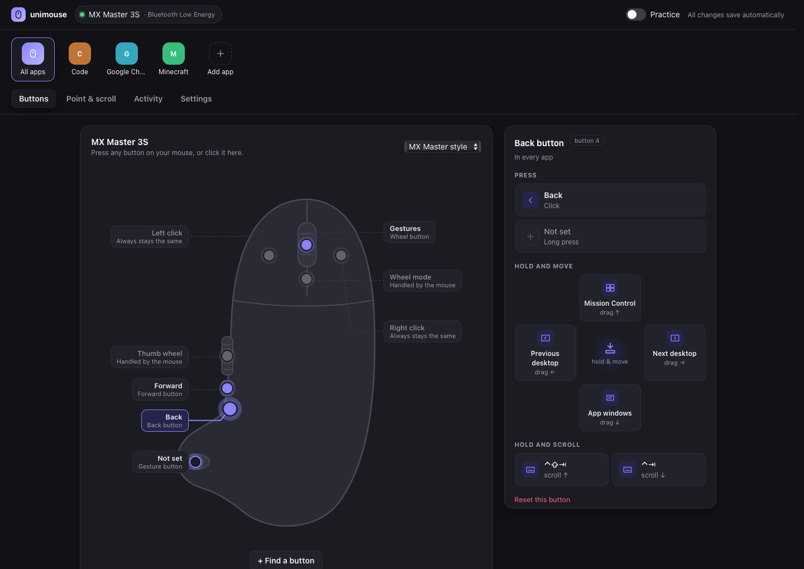
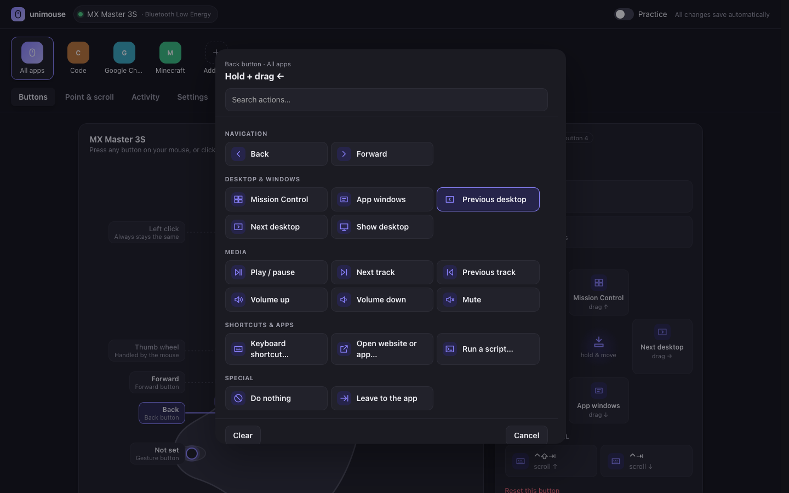
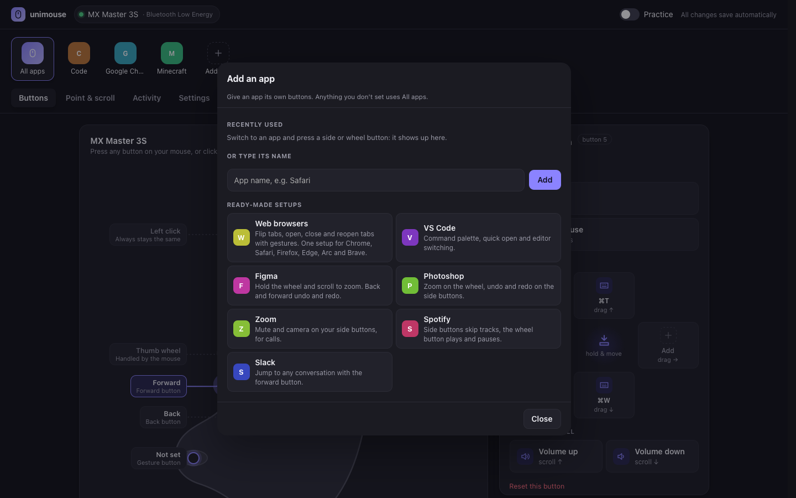

# unimouse

**One mouse setup for macOS, Windows and Linux.** Remap every button, add gestures, give each app its own
buttons, and get smooth trackpad-style scrolling, from one small program and one config file that works the
same on all three.



- **Every button, every way you use it**: click, long press, hold and drag in four directions, hold and scroll.
- **A drawing of your mouse**: unimouse reads your mouse's name and draws it (MX Master, 5-button, gaming),
  with every button labelled. Press a real button and it lights up and opens.
- **Per-app setups**: different buttons in Chrome, VS Code or Figma, with one-click ready-made setups.
- **One file for every computer**: `mod+t` means ⌘T on a Mac and Ctrl+T elsewhere, and app sections match
  each OS's name for the same app. Keep the file in Dropbox or iCloud and every machine behaves the same.
- **Smooth scrolling**: notched wheels glide like a trackpad; quick flicks go further. Trackpads are left alone.
- **Practice mode**: try gestures and see what they'd do, without anything happening.
- **Scripts on a button**: `run:` any command, so a button can trigger an automation or an AI tool.
- **Small and private**: one ~1 MB program, no account, no telemetry, no network access beyond your own machine.

## Platform support

| | macOS | Windows | Linux |
|---|---|---|---|
| Middle, back, forward buttons | ✅ | ✅ | ✅ |
| Extra buttons (6 and up) | ✅ | not yet | button 6 |
| Gestures, long press, hold + scroll | ✅ | ✅ | ✅ |
| Smooth scrolling | ✅ | ✅ | ✅ |
| Per-app settings | ✅ | ✅ | ✅ on X11 |
| Mouse name in the settings app | ✅ | not yet | ✅ |
| Start at login | ✅ launchd | ✅ Run key | ✅ XDG autostart |

Works with any mouse that sends normal button events. Some buttons never reach your computer as buttons (for
example the MX Master's wheel-mode button, which is handled inside the mouse) and can't be remapped by any
app other than the maker's.

## Install

### Download

Grab the build for your system from the Releases page, unpack it, and put `unimouse` somewhere on your `PATH`.

On macOS the build isn't notarized yet, so clear the download flag once:

```sh
xattr -d com.apple.quarantine ./unimouse
```

### From source

With [Rust](https://rustup.rs) 1.89 or newer:

```sh
cargo install --path .
```

## Quick start

```sh
unimouse --settings
```

This starts unimouse and opens the settings app in your browser. Then:

1. **Allow access** (macOS: Accessibility; Linux: see below). The settings app tells you if something's missing
   and takes you to the right place.
2. **Pick a button** on the drawing, or press it on your mouse, and choose what it does.
3. **Keep it running**: turn on *Start at login* in Settings, or run `unimouse --install`.

Changes save as you make them and apply on your next click.

## Permissions

- **macOS**: System Settings → Privacy & Security → **Accessibility**, then add `unimouse` (or your terminal
  while developing). unimouse waits until access is granted, no restart needed. Unsigned builds need access
  granted again after each rebuild.
- **Windows**: none.
- **Linux**: read access to your mice and write access to `/dev/uinput`:

  ```sh
  sudo usermod -aG input $USER
  echo 'KERNEL=="uinput", GROUP="input", MODE="0660"' | sudo tee /etc/udev/rules.d/99-unimouse.rules
  sudo modprobe uinput && sudo udevadm control --reload && sudo udevadm trigger
  ```

  Then log out and back in.

## The settings app

`unimouse --settings` opens the settings app in your browser. It's served by unimouse itself, only to your own
machine, so it looks the same on every OS.

| Pick an action | Ready-made app setups |
|---|---|
|  |  |

- **Buttons**: the drawing of your mouse, and for the selected button: click, long press, a *hold and move*
  compass, and *hold and scroll*. Each opens a searchable action list with a shortcut recorder.
- **Point & scroll**: smooth scrolling, speed, wheel direction, gesture sensitivity, and a test pad to feel it.
- **Activity**: every press unimouse sees and what it did. Use it to find out what your mouse sends.
- **Settings**: start at login, your app list, and where the config file lives.
- **Setup check**: warns when access is missing, or when Logi Options+, G HUB, Razer Synapse or a similar tool
  is running and could take your buttons first, with the fix.
- **Undo**: ⌘Z / Ctrl+Z, or the Undo button on each saved change.

## The config file

Everything the settings app does is saved to one plain-text file, so you can also edit it by hand, keep it in a
synced folder, or share it. Edits apply on the next click.

| OS | Default location |
|---|---|
| macOS | `~/Library/Application Support/unimouse/config.toml` |
| Windows | `%APPDATA%\unimouse\config.toml` |
| Linux | `~/.config/unimouse/config.toml` |

```toml
drag_threshold = 40   # pixels before a hold counts as a drag
hold_ms        = 400  # how long a long press is

[scroll]
smooth  = true
speed   = 1.0
reverse = false

[default]                              # every app
button4 = "back"
button5 = "forward"
button4_drag_left   = "prev_desktop"
button4_drag_right  = "next_desktop"
button5_scroll_up   = "volume_up"      # hold forward + scroll = volume
button5_scroll_down = "volume_down"
button5_hold        = "play_pause"
button3_hold        = "run:~/bin/ask-ai.sh"

[app."google chrome|chrome|google-chrome"]   # Chrome on macOS, Windows and Linux
button5_drag_left = "keys:mod+shift+t"       # reopen closed tab

[app."adobe photoshop*"]                      # * matches any version
button4 = "keys:mod+z"

[app."minecraft|javaw"]
button4 = "native"   # leave the button to the game
scroll  = "native"   # and the wheel
```

**Triggers**: `buttonN` (3 = middle, 4 = back, 5 = forward, 6 and up = extra buttons), plus `_hold`,
`_drag_left` / `_right` / `_up` / `_down`, and `_scroll_up` / `_scroll_down`.

**Actions**

| Action | What it does |
|---|---|
| `back`, `forward` | Browser and file-manager back and forward |
| `mission_control`, `app_windows`, `prev_desktop`, `next_desktop`, `show_desktop` | Desktop and window overviews |
| `volume_up`, `volume_down`, `mute`, `play_pause`, `next_track`, `prev_track` | Media keys |
| `keys:mod+shift+t` | A keyboard shortcut. `mod` = ⌘ on macOS, Ctrl elsewhere; also `cmd`/`win`, `ctrl`, `alt`/`opt`, `shift` |
| `open:https://…` | Open a website, file, folder or app |
| `run:command` | Run a shell command (`sh` on macOS/Linux, `cmd` on Windows) |
| `none` | Swallow the button |
| `native` | Leave the button to the app |

A button with gestures but no click action still clicks normally. Left and right click are never remapped, so
you can't lock yourself out. [config.example.toml](config.example.toml) has the full, commented example.

## Command line

```text
unimouse [config.toml] [--settings | --install | --uninstall]
  --settings   open the settings app (starts unimouse if it isn't running)
  --install    start at login (and now, in the background)
  --uninstall  stop, and don't start at login
```

Pass a config path to use a file in a synced folder. Only one copy runs at a time.

## Troubleshooting

- **A button does nothing / doesn't show up in Activity.** Check the setup check at the top of the settings app.
  Mouse software like Logi Options+ or G HUB often takes buttons first; pause it. Some buttons are handled inside
  the mouse and never reach the computer.
- **Every action happens twice.** Two copies are running, or another remapper handles the same button.
- **It stopped working after an update (macOS).** Remove `unimouse` from Accessibility and add it again.
- **Per-app settings don't apply on Linux.** They need X11; Wayland has no standard way to ask which app is in
  front.
- **Middle-drag panning broke in an app.** Buttons with gestures re-send their click on release; set the button to
  `native` for that app.

## How it works

unimouse listens to mouse input below your apps, turns presses, moves and scrolls into actions, and sends the
results back as ordinary keyboard, mouse and scroll events.

| Part | File | What it does |
|---|---|---|
| Engine | `src/engine.rs` | Config, per-app profiles, gesture detection, `open:`/`run:` |
| Smooth scrolling | `src/scroll.rs` | Ease-out animation with flick acceleration |
| Settings app | `src/ui.rs`, `src/ui.html` | Local web UI and its API |
| Start at login | `src/install.rs` | launchd agent / Run key / XDG autostart |
| macOS | `src/mac.rs` | `CGEventTap` in, `CGEventPost` out |
| Windows | `src/win.rs` | `WH_MOUSE_LL` hook in, `SendInput` out |
| Linux | `src/linux.rs` | evdev in (grabs the real mice), uinput out; works on X11 and Wayland |

The settings app only listens on `127.0.0.1`, and every request needs a random per-run token and the exact
`Host`, so websites can't reach it. See [SECURITY.md](SECURITY.md).

## Known limits

- Long press fires on release, not while you're still holding.
- Hold + scroll uses whole wheel notches, so free-spin wheels don't trigger it.
- macOS built-in actions assume the default Mission Control shortcuts.
- Linux desktop actions use GNOME's shortcuts; mice plugged in later are picked up on the next start.
- Scroll frames run on a 120 Hz timer, not in sync with the display.
- Saving from the settings app rewrites the config file without its comments.

## Roadmap

Ideas where help is especially welcome:

- Menu-bar / tray icon
- Logitech HID++ support, so the MX Master gesture button works without Logi Options+
- Windows Raw Input, for buttons 6 and up
- Front-app detection on Wayland (GNOME and KDE)
- Button chords (press 4 and 5 together) and per-mouse profiles
- Display-synced scroll frames

## Contributing

Issues and pull requests are welcome. [CONTRIBUTING.md](CONTRIBUTING.md) covers building, testing (including
previewing the settings app without a mouse) and where to start.

## Acknowledgements

unimouse is its own code, but it learned from [Mac Mouse Fix](https://github.com/noah-nuebling/mac-mouse-fix),
[Karabiner-Elements](https://github.com/pqrs-org/Karabiner-Elements), [LinearMouse](https://github.com/linearmouse/linearmouse)
and [Solaar](https://github.com/pwr-Solaar/Solaar). If unimouse isn't right for you, they're excellent.

## License

Licensed under either of [Apache License 2.0](LICENSE-APACHE) or [MIT license](LICENSE-MIT) at your option.
Unless you explicitly state otherwise, any contribution you submit for inclusion in this project, as defined in
the Apache-2.0 license, shall be dual licensed as above, without any additional terms or conditions.
